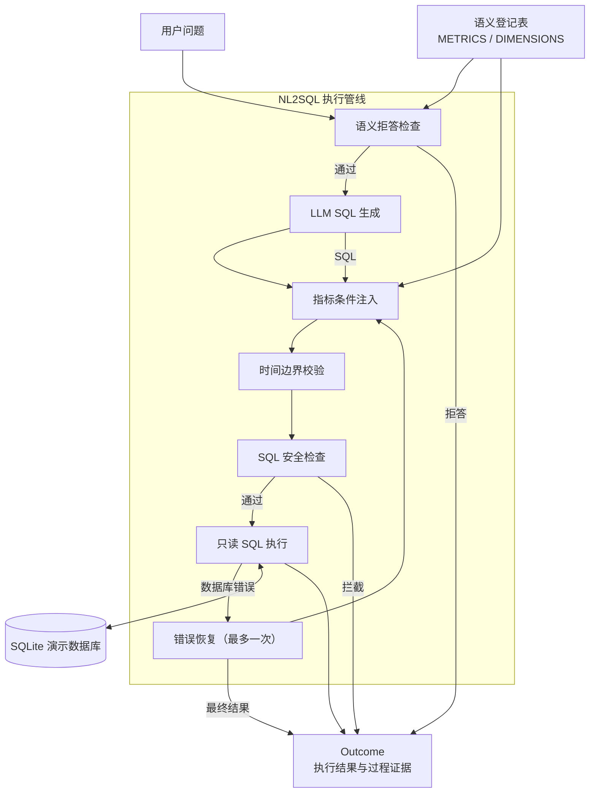

# Data Agent

**一个面向电商业务场景的可信 NL2SQL 问数系统。**

用户通过自然语言提出数据问题，Agent 理解查询需求、生成 SQL，在经过语义规则校验和多层安全检查后，只读执行数据库查询，最终返回数据结果及完整的执行依据。

例如：

- 上个月的销售额是多少？
- 各渠道的销售额分别是多少？
- 最近几个月的销售额有什么变化？
- 按渠道统计订单数量。

项目使用 `customers` 和 `orders` 构建本地演示数据集，重点探索如何在 LLM 生成 SQL 存在不确定性的情况下，通过确定性代码约束查询行为，降低错误查询、危险 SQL 和业务口径偏差带来的风险。

**核心设计理念：不依赖模型自觉保证正确性，而是让系统能够检查、约束、记录和验证模型行为。**

---

## 核心功能

### 1. 自然语言转 SQL

基于 OpenAI 兼容模型接口，将用户的自然语言问题转换为 SQL 查询。

执行流程：

1. 接收用户问题。
2. 检查问题涉及的指标、维度及业务限定词是否已定义。
3. 获取数据库 Schema，调用 LLM 生成 SQL。
4. 对 SQL 执行语义规则注入和时间边界校验。
5. 通过静态安全检查。
6. 使用 SQLite 只读连接执行查询。
7. 返回查询结果、SQL 及执行过程中的校验记录。

采用线性执行管线组织主要处理步骤，仅在语义拒答环节使用 LangGraph 进行条件分支编排。

### 2. 三层可信防线

项目最核心的设计是将数据可信保障拆分为三个独立环节，而不是仅依赖 Prompt 要求模型生成正确 SQL。

| 风险场景 | 处理机制 | 系统行为 |
|---|---|---|
| 指标、维度或业务限定词未定义 | 答前语义拒答 | 停止 SQL 生成，明确说明缺失内容及支持范围 |
| SQL 缺少必要业务条件或时间边界错误 | 答后规则注入与修正 | 自动补充或修正 SQL，并记录修改前后的差异 |
| SQL 包含写操作或危险函数 | 执行前安全检查 | 拦截 SQL，不进入数据库执行 |

**第一层：语义拒答**

在调用模型生成 SQL 之前，检查用户问题是否超出系统已定义的业务语义范围。

- 使用 `METRICS` 和 `DIMENSIONS` 维护指标、维度及其别名。
- 检查问题中的指标、维度和业务限定词是否有明确依据。
- 对未定义指标、不支持的维度及未知限定词进行拒答。
- 拒答时明确指出缺失内容，并提供当前支持的查询范围。

这一环节使用确定性规则，不调用 LLM，避免模型自行编造业务指标或维度。

**第二层：语义规则注入与修正**

针对模型可能遗漏业务条件的问题，在 SQL 执行前进行确定性处理。

- **指标条件注入**：根据指标定义强制补充必要过滤条件，例如销售额必须限定 `status = 'paid'`。
- **冲突条件修正**：模型生成的过滤条件与指标定义冲突时，以系统登记的规则为准进行修正。
- **时间边界校验**：针对 DATETIME 字段，将可能遗漏当天数据的日期闭区间改写为半开区间。
- **查询块定位**：识别顶层查询、CTE、派生表和子查询，将业务条件注入实际引用目标数据表的查询块，避免错误地修改外层查询。

所有系统修改均记录在 `enforcement` 和 `time_fix` 中，保留修改动作及必要的 `from` / `to` 信息。

**第三层：SQL 安全执行**

采用多层安全措施限制模型生成的 SQL：

- 静态 SQL 校验：只允许单条 `SELECT` / `WITH` 查询。
- 危险语句拦截：禁止 INSERT、UPDATE、DELETE、DROP 等写操作。
- 危险函数拦截：禁止 `load_extension`、`readfile`、`writefile` 等危险函数。
- SQLite 只读连接：使用 `mode=ro` 打开数据库。
- SQLite Authorizer：采用操作白名单，进一步限制数据库层面的执行行为。
- 行数限制：通过查询结果截断机制控制最大返回行数。
- 超时控制：通过 `set_progress_handler` 中断超时查询。

安全校验失败时，系统返回具体拦截规则，不执行对应 SQL。

### 3. 有界错误恢复

针对 SQL 语法或数据库执行错误，提供一次受限的自动修复机制。

1. 首次 SQL 执行失败。
2. 将失败 SQL 和数据库错误信息反馈给模型。
3. 模型重新生成 SQL。
4. 修复后的 SQL 重新经过语义规则处理、安全检查和只读执行。
5. 最多重试一次，仍然失败则返回错误。

该机制只针对真实模型生成的 SQL，测试用的 `injected_sql` 通道不触发模型重试。

通过限制重试次数，避免错误恢复陷入无限循环，同时保留失败现场和修复结果。

### 4. 可追溯的执行结果

系统不仅返回查询结果，还通过统一的 `outcome` 对象记录执行过程。

主要包括：

- `question`：用户原始问题。
- `status`：查询最终状态。
- `sql`：最终处理的 SQL。
- `guard`：SQL 安全校验结果及拦截原因。
- `enforcement`：指标业务条件注入记录。
- `time_fix`：时间边界修正记录。
- `retry`：错误恢复过程记录。
- `result`：数据库查询结果。
- `error`：错误类型及具体信息。
- `caliber_note`：模型提供的业务口径声明。
- `elapsed_ms`：端到端执行耗时。

这样可以区分模型原始生成内容与系统后续处理结果，回答诸如：

- SQL 是否被系统修改过？
- 必要的订单状态条件是谁补充的？
- 时间边界是否经过修正？
- SQL 是否被安全规则拦截？
- 数据库执行失败后是否进行过修复？

**可信性不仅体现在最终结果，还体现在结果产生过程是否可检查、可验证。**

---

## 系统架构

项目采用分层管线设计，将自然语言理解、SQL 生成、语义规则处理、安全执行和评测职责分离。



### 模块职责

| 模块 | 职责 |
|---|---|
| `pipeline` | 统一执行入口，组织完整查询流程 |
| `pipeline_steps` | 编排各阶段处理步骤及结果记录 |
| `semantic_tables` | 维护指标、维度及业务语义定义 |
| `services/semantic_check` | 问题语义检查与拒答判定 |
| `services/metrics` | 指标必要条件注入 |
| `services/time_boundary` | SQL 时间边界校验与修正 |
| `services/sql_guard` | SQL 静态安全检查 |
| `services/executor` | SQLite 只读查询执行 |
| `graph` | 基于 LangGraph 实现语义拒答分支 |
| `evaluation` | 评测用例执行、断言判定和报告生成 |
| `web` | FastAPI 服务接口与 SSE 进度输出 |
| `frontend` | React 问数交互与执行证据展示 |

### 技术栈

| 技术 | 用途 |
|---|---|
| Python 3.11+ | 后端开发 |
| OpenAI SDK | OpenAI 兼容模型接口 |
| LangGraph | 语义拒答分支编排 |
| SQLite | 本地演示数据库及只读查询 |
| FastAPI | HTTP API |
| SSE | 实时传递执行阶段进度 |
| React 19 | 问数交互前端 |
| Vite + TypeScript | 前端工程化 |
| pytest | 自动化测试 |

---

## Web 演示

项目提供 React 问数前端和 FastAPI 服务端，可以直观展示 NL2SQL 执行过程及可信机制。

主要功能：

- **自然语言问数**：通过输入框提交业务问题。
- **实时执行进度**：通过 SSE 展示语义检查、SQL 生成、安全校验和查询执行等阶段。
- **SQL 展示**：查看最终执行 SQL。
- **执行证据面板**：展示业务条件注入、时间边界修正及错误恢复记录。
- **安全拦截反馈**：展示被拦截的 SQL 及具体原因。
- **语义拒答补全**：针对缺失的指标、维度或限定词提供可选补全建议。

前端不是独立实现另一套问数逻辑，而是通过 API 调用统一的 `pipeline.ask()`，展示后端已经产生的执行结果和过程记录。

<details>
<summary>Web 服务接口</summary>

| 接口 | 说明 |
|---|---|
| `POST /api/ask` | 提交问数请求，SSE 返回阶段进度和最终结果 |
| `GET /api/meta` | 获取指标、维度及示例问题 |
| `GET /api/health` | 检查服务配置和数据库状态 |

请求侧还包含参数白名单、并发限制和日配额控制。

</details>

---

## 快速开始

### 环境要求

- Python 3.12（推荐）
- uv
- 可用的 OpenAI 兼容模型 API
- Node.js 22+（仅 Web 前端需要）

### 1. 克隆项目

```bash
git clone <your-repository-url>
cd data-agent
```

### 2. 创建环境并安装依赖

```bash
uv venv --python 3.12
source .venv/bin/activate

uv pip install -e ".[dev]"
```

### 3. 初始化演示数据库

```bash
python scripts/init_db.py
```

默认生成 `data/demo.db`，包含 `customers` 和 `orders` 两张业务表。

如果数据库已经存在，可以使用 `--force` 重建：

```bash
python scripts/init_db.py --force
```

### 4. 配置模型

```bash
cp .env.example .env
```

编辑 `.env`：

```dotenv
OPENAI_API_KEY=your-api-key
DATA_AGENT_MODEL=your-model-name

# 可选：OpenAI 兼容 API 地址
OPENAI_BASE_URL=https://your-api-endpoint/v1
```

其他配置：

| 环境变量 | 默认值 | 说明 |
|---|---|---|
| `DATA_AGENT_DB_PATH` | `data/demo.db` | 数据库路径 |
| `DATA_AGENT_MAX_ROWS` | `200` | 最大返回行数 |
| `DATA_AGENT_QUERY_TIMEOUT` | `5` | SQL 执行超时时间（秒） |

系统环境变量优先于 `.env` 配置。真实 API Key 和本地数据库文件不会提交到 GitHub。

### 5. 运行问数

```bash
python -m data_agent.cli "上个月销售额是多少"
```

输出 JSON：

```bash
python -m data_agent.cli "上个月销售额是多少" --json
```

查看完整执行链路：

```bash
python -m data_agent.cli "上个月销售额是多少" --debug
```

### 6. 启动 Web 演示

Web 依赖为可选依赖组。

安装：

```bash
uv pip install -e ".[web]"
```

准备独立的 Web 演示数据库：

```bash
python scripts/init_db.py --db data/web_demo.db
```

启动后端（终端 1）：

```bash
DATA_AGENT_DB_PATH=data/web_demo.db \
uv run --no-sync uvicorn web.server.app:build_app --factory --port 8000
```

启动前端（终端 2）：

```bash
cd frontend
npm install
npm run dev
```

访问：

```text
http://localhost:5173
```

前端通过 Vite Proxy 将 `/api` 请求转发到本地 FastAPI 服务。

---

## 测试与评测

项目将工程测试和真实模型行为评测分开，避免将单元测试通过等同于 Agent 实际表现可靠。

### 1. 自动化测试

运行：

```bash
pytest -q
```

<badge color="success">369 passed</badge> <text color="secondary" size="xs">2026-11-17 前已记录的测试基线，发布时应以实际复跑结果为准</text>

当前记录包含 369 条 pytest 测试，全部不调用真实大模型。

主要覆盖：

- SQL 静态校验和危险语句拦截。
- SQLite 只读连接及 Authorizer 权限约束。
- 查询行数限制和执行超时。
- 指标条件注入及冲突修正。
- DATETIME 时间边界修正。
- 语义拒答与 LangGraph 分支。
- 错误恢复及重试边界。
- Web API、SSE 和执行结果契约。
- 评测器断言与报告生成。
- 演示数据库生成及数据一致性。

前端拒答补全规则另有 8 条独立夹具断言：

```bash
node --experimental-strip-types frontend/scripts/test_refusal.mjs
```

### 2. 真实模型评测

项目建立了分阶段评测体系，使用独立的测试用例、预期结果和确定性断言验证 Agent 行为。

当前共 57 条评测用例：

| 阶段 | 测试内容 | 用例数 | 状态 |
|---|---|---:|---|
| v0 | SQL 只读防线及安全攻击用例 | 8 | <badge color="success">Done</badge> |
| v1 | 业务口径、空结果及语义拒答 | 9 | <badge color="success">Done</badge> |
| v2 | 真实分布问题 Golden Set | 40 | <badge color="success">Done</badge> |

v2 Golden Set 验收结果：

<box border radius="lg" padding={3} gap={3}>
  <grid columns={2} gap={3}>
    <grid-item>
      <title size="2xl" color="success" tabularNums>40/40</title>
      <text color="secondary" size="xs">用例通过</text>
    </grid-item>
    <grid-item>
      <title size="2xl" color="success" tabularNums>120/120</title>
      <text color="secondary" size="xs">三轮样本通过</text>
    </grid-item>
  </grid>
  <divider color="subtle"/>
  <text weight="medium" size="sm">2026-11-07 阶段 4 验收结果</text>
  <text color="secondary" size="xs">40 条 Golden Case，每条重复运行 3 次。当前验收快照记录零挂账豁免。</text>
</box>

评测不仅检查 SQL 是否能够执行，还会验证：

- SQL 是否符合预期业务条件。
- 查询结果是否符合预设数值。
- 危险 SQL 是否被正确拦截。
- 未定义的业务语义是否得到拒答。
- 系统是否正确记录 SQL 修改及执行过程。

运行方式：

```bash
# 日常运行：只执行 v0 安全测试，不需要真实模型
python -m evaluation.run_eval --stage v0

# 指定用例增量验证，重复一次
python -m evaluation.run_eval --all --ids E1,E2,E3 --repeats 1

# 单独验收 v2 Golden Set
python -m evaluation.run_eval --stage v2 --repeats 3

# 全量评测
python -m evaluation.run_eval --all
```

全量评测涉及真实模型调用，建议根据实际修改范围选择用例，避免不必要的模型调用成本。

评测报告保存在 `docs/eval_report_*.json`，记录每次评测的运行环境、用例结果及相关证据。

---

## 已知限制

当前项目定位为本地运行的工程实践和技术展示项目，并非已经完成生产部署的企业级数据分析平台。

| 领域 | 当前限制 |
|---|---|
| 数据库 | 使用 SQLite 演示数据，不包含真实业务数据接入 |
| 指标口径 | 已实现部分必要条件强制注入，金额公式和时间字段选择尚未形成完整运行时校验 |
| 语义理解 | 使用确定性别名匹配，不支持模糊语义识别和向量语义检索 |
| 维度取值 | 已检查指标和维度定义，但未完整校验所有维度取值的合法性 |
| 结果验证 | 目前主要识别空结果，尚未实现异常量级、数据分布和跨源对账验证 |
| SQL 生成 | 生成质量仍受模型能力影响，系统不能保证所有 SQL 和业务结论都正确 |
| 会话管理 | Web 前端暂不支持持久化会话及多轮上下文 |
| 用户权限 | 尚未实现完整用户认证、业务级授权和审计体系 |
| 评测 | 当前以确定性断言为主，测试集规模和业务覆盖仍有限 |

需要特别说明：系统能够约束部分 SQL 风险和已登记的业务规则，但这不意味着所有指标口径、数据源和最终分析结论都已经得到完整验证。

---

## 项目文档

| 文档 | 内容 |
|---|---|
| [需求文档](docs/REQUIREMENTS.md) | 项目需求及业务范围 |
| [技术决策](docs/TECH_DECISIONS.md) | 技术选型及设计取舍 |
| [评测设计](docs/EVAL_DESIGN.md) | 评测体系、验收标准及覆盖范围 |
| [Web 演示方案](docs/WEB_DEMO_PLAN.md) | FastAPI 与 React 前端设计 |
| [阶段 4 方案](docs/STAGE4_AST_PLAN.md) | SQL 查询块识别及指标条件注入修复 |
| [函数接口说明](NOTES.md) | 核心模块函数、参数及返回值 |
| [评测接口说明](evaluation/NOTES.md) | 评测执行与判定机制 |
| [评测用例](problems/eval_cases.json) | 57 条测试用例及预期结果 |

---

## 项目总结

Data Agent 关注的不是简单地让 LLM 将自然语言翻译成 SQL，而是探索如何让模型生成的查询在业务规则和执行安全的约束下运行。

项目重点实践：

- **语义约束**：通过指标和维度登记表控制模型的业务认知边界。
- **确定性 SQL 处理**：将必要业务条件和时间边界从模型生成行为中剥离出来。
- **纵深安全防护**：静态检查、只读连接和数据库 Authorizer 多层限制 SQL 执行。
- **过程可追溯**：通过结构化执行结果记录模型输出、系统修改和执行状态。
- **行为可验证**：通过 Golden Set、自动化测试和真实模型评测验证系统行为。

**核心目标：让 LLM 负责理解和生成，让确定性系统负责约束和验证。**
